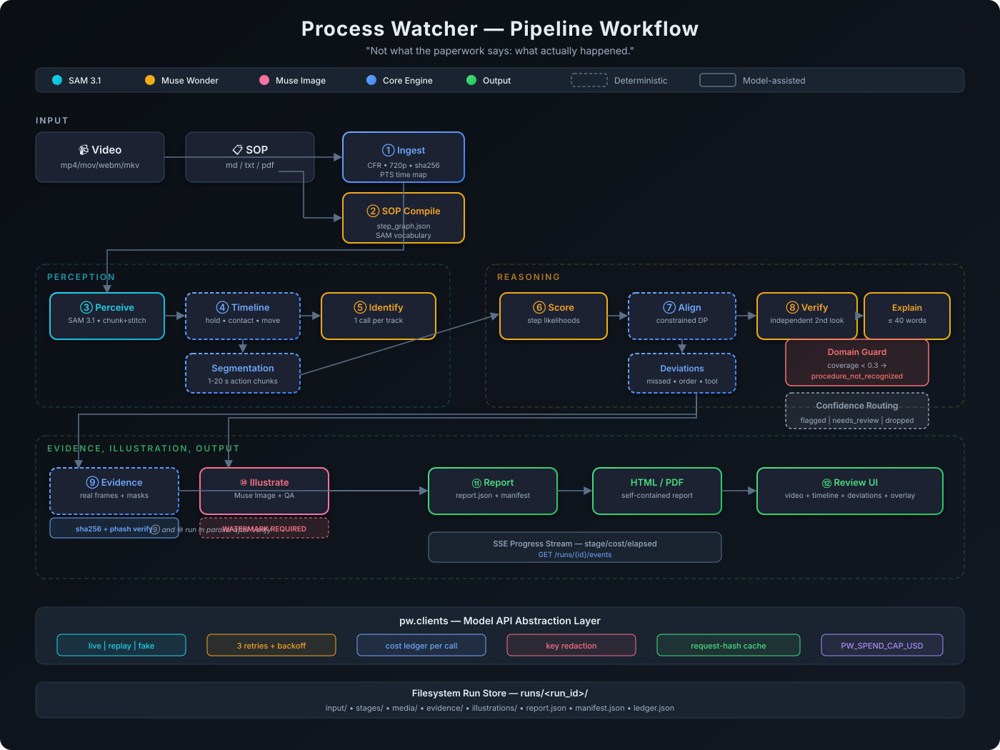

# 🔍 Process Watcher

> *"Not what the paperwork says: what actually happened."*

Process Watcher verifies recorded physical procedures against standard operating procedures (SOPs). It detects **missed steps**, **out-of-order execution**, and **wrong tools**, providing exact timestamps, explanations, and visual evidence with SAM-annotated real video frames.

Built for the **Meta Global AI Developer Hackathon**.

---

## 📐 System Workflow Architecture



The pipeline integrates three Meta AI models with deterministic alignment logic across 12 discrete stages:

```
[ Video Input ] ──► (1) Ingest 720p CFR ──► (2) SAM 3.1 Tracking ──► (3) Track Stitching
                                                                           │
[ Written SOP ] ──► (5) Muse Wonder Compile ──► (6) Cost Gate ───► (4) Interaction Timeline
                                                        │                  │
                                                        ▼                  ▼
                                                  (7) Deterministic DP Alignment
                                                              │
                                                              ▼
                                                  (8) Deviation Classifier
                                                  [missed | order | tool]
                                                              │
                     ┌────────────────────────────────────────┴───────────────────────┐
                     ▼                                                                ▼
         (9) Evidence Extractor                                       (11) Muse Image Gen
         (Real Frames + SAM Masks)                                     ("What correct looks like")
                     │                                                                │
                     ▼                                                                ▼
         (10) Muse Wonder Verifier ───► [ (12) Report JSON + Web UI Dashboard ] ◄─────┘
```

---

## 🗂️ Project File Architecture

Process Watcher follows senior-grade software architecture standards with a clean `src` layout, comprehensive typed contracts, and isolated workspaces:

```
ProcessWatcher/
├── contracts/                       # JSON Schemas (Single Source of Truth)
│   ├── schemas/                     # sop, tracks, timeline, alignment, report schemas
│   └── examples/                    # Golden JSON fixture examples
├── docs/                            # Architectural & Specification Documentation
│   ├── 01_PRD.md                    # Product Requirements & Acceptance Criteria
│   ├── 02_AppFlow.md                # User Journeys, Screen Map & State Machines
│   ├── 03_UI_Spec.md                # Design System, Tokens, Accessibility Specs
│   ├── 04_TRD.md                    # Technical Architecture, Algorithms & Protocols
│   ├── 05_Schema.md                 # Entity Relations & Access Control Rules
│   ├── 06_Plan.md                   # 74-Task Master Plan & Gates
│   ├── PROGRESS.md                  # Active Owner Handoff Ledger
│   ├── workflow.svg                 # Pipeline Workflow Diagram
│   ├── adr/                         # Architecture Decision Records (ADR-000 to ADR-005)
│   ├── bench/                       # Benchmark Protocol & Scorecards
│   ├── demo/                        # Hackathon Walkthrough Guides
│   ├── finals/                      # Submission Explainers & Scripts
│   ├── results/                     # Test Run Artifacts & Verification Logs
│   ├── security/                    # Threat Models & Security Audits
│   └── submission/                  # Hackathon Video & Devpost Writeups
├── src/                             # Python 3.12 Backend Source Root
│   └── pw/
│       ├── api/                     # FastAPI Endpoints (/runs, /evidence, /healthz)
│       ├── clients/                 # Model API Clients (live, replay, fake) + Ledger
│       ├── core/                    # Run Store, Config, Type Models
│       ├── ingest/                  # Video CFR normalization & PTS time mapping
│       ├── pipeline/                # 12-Stage DAG Execution Orchestrator
│       ├── security/                # Access Code validation, Path Traversal shields
│       ├── perception/              # SAM 3.1 client, chunking & polygon masks
│       ├── timeline/                # Hand-object contacts & interaction events
│       ├── sop/                     # Muse Wonder SOP parsing & step graph builder
│       ├── align/                   # Constrained DP sequence aligner
│       ├── illustrate/              # Muse Image reference generator (watermarked)
│       ├── evidence/                # Keyframe extraction & SVG/mask rendering
│       ├── report/                  # Report assembly, summaries & JSON export
│       ├── bench/                   # Benchmark harness, ablation & metric scorers
│       ├── data/                    # Dataset validation, hashing & integrity
│       └── demo/                    # Offline demo mode & preloaded bundles
├── tests/                           # Pytest Test Suites (Mirrors src/pw)
│   ├── api/                         # REST endpoint tests
│   ├── clients/                     # Meta API mock/replay tests
│   ├── perception/                  # SAM chunking and stitching unit tests
│   ├── align/                       # DP alignment coverage tests (≥90% req)
│   ├── timeline/                    # Event detection coverage tests (≥90% req)
│   ├── robustness/                  # Fault injection, corrupt video, dropped frames
│   └── fixtures/                    # Golden frames, clips & test SOPs
├── web/                             # Frontend Application (React + Vite + TypeScript)
│   ├── src/
│   │   ├── app/                     # App router & layout shell
│   │   ├── api/                     # Typed client for pw backend
│   │   ├── ui/                      # Design system primitives & tokens
│   │   ├── features/                # Runs, Report, Evidence Viewer, SOP Graph
│   │   └── types/generated/         # Auto-generated TypeScript types from schemas
│   └── e2e/                         # Playwright End-to-End Test Suite
├── bench/                           # Benchmark Dataset Workspace
│   ├── sops/                        # 3 Standard SOP ground truths
│   ├── golden/                      # Golden step graphs
│   ├── dev/                         # 15 development evaluation clips
│   └── heldout/                     # 9 held-out evaluation clips (HELDOUT.lock)
├── config/                          # Static configuration & frozen thresholds
├── demo/cases/                      # Packaged, checksummed demo runs
└── scripts/                         # Operational & Scaffolding Utilities
```

---

## 📋 Implementation Phases & Functional Cards

### Phase 0 — Foundation, Spikes & Walking Skeleton (Day 1)
- **`[CARD: ENV-SETUP]`** Python 3.12 `uv` workspace, `ruff`, `mypy`, `pytest`, `pre-commit` gitleaks (`T-0.2`)
- **`[CARD: FE-SCAFFOLD]`** React 18, Vite, TypeScript strict, Vitest, component tokens (`T-0.3`)
- **`[CARD: MODEL-SPIKES]`** SAM 3.1 API bounds (`T-0.4`), Muse Wonder JSON structured output (`T-0.5`), Muse Image modes (`T-0.6`)
- **`[CARD: CORE-CLIENTS]`** Unified model client layer (`pw.clients`) with `live`, `replay`, `fake` modes, retries, and spend ledger (`T-0.7`)
- **`[CARD: SKELETON-DAG]`** 12-stage pipeline DAG, CLI runner, FastAPI service (`T-0.8`)
- **`[CARD: CI-PIPELINE]`** GitHub Actions CI for lint, typecheck, tests, and gitleaks (`T-0.9`)

### Phase 1 — Data, Contracts & Eval Harness (Days 1–3)
- **`[CARD: CONTRACTS]`** JSON Schemas for SOP, tracks, timeline, alignment, report + auto-generated TS types (`T-1.1`, `T-1.2`)
- **`[CARD: BENCH-DATA]`** 3 SOPs, 15 dev clips, 9 held-out clips, golden annotations (`T-1.3` – `T-1.5`)
- **`[CARD: EVAL-ENGINE]`** Precision/Recall/F1 metrics, false flag penalties, MAE, benchmark runner (`T-1.6` – `T-1.8`)

### Phase 2 — Perception & Interaction Timeline (Days 2–4)
- **`[CARD: VIDEO-INGEST]`** Variable frame rate (VFR) to CFR 720p normalization with PTS time-mapping (`T-2.1`)
- **`[CARD: SAM-TRACKING]`** SAM 3.1 chunk runner, Hungarian matching track stitcher, mask RLE utilities (`T-2.2` – `T-2.4`)
- **`[CARD: TIMELINE-EVENTS]`** Hand-object contact detection, action segmentation, event classification (`T-2.5` – `T-2.8`)
- **`[CARD: PERCEPTION-EVAL]`** Visual mask overlays and perception validation on dev set (`T-2.9`, `T-2.10`)

### Phase 3 — Reasoning: SOP Compile, Alignment & Deviations (Days 3–5)
- **`[CARD: SOP-COMPILER]`** Muse Wonder SOP extraction to typed DAG of steps, tools, and constraints (`T-3.1` – `T-3.3`)
- **`[CARD: DP-ALIGNMENT]`** Deterministic constrained sequence alignment engine with strict monotonicity (`T-3.4`, `T-3.5`)
- **`[CARD: DEVIATION-LOGIC]`** Classification of missed steps, out-of-order execution, and wrong tools (`T-3.6`)
- **`[CARD: VERIFIER-GATE]`** Second-pass Muse Wonder verifier for high-confidence flag confirmation (`T-3.7`)

### Phase 4 — Evidence, Illustration & Report Assembly (Days 4–6)
- **`[CARD: EVIDENCE-FRAMES]`** Real-frame keyframe extraction with SAM contour overlays (`T-4.1`, `T-4.2`)
- **`[CARD: MUSE-ILLUSTRATE]`** Muse Image reference diagrams with explicit watermarking (`T-4.3`)
- **`[CARD: REPORT-BUILDER]`** Final JSON report synthesis, executive summary, and PDF export (`T-4.4` – `T-4.6`)

### Phase 5 — Web Application (Days 4–7)
- **`[CARD: WEB-UPLOAD]`** Video/SOP upload screen with client-side validation and progress telemetry (`T-5.1`)
- **`[CARD: WEB-TIMELINE]`** Interactive video player synchronized with SOP step timeline and SAM tracks (`T-5.2`)
- **`[CARD: WEB-DEVIATIONS]`** Side-by-side evidence card viewer comparing actual frames against SOP diagrams (`T-5.3`)
- **`[CARD: WEB-EXPORT]`** Audit report viewing, filtering, and export capabilities (`T-5.4`, `T-5.5`)

### Phase 6 — Benchmark, Tuning & Robustness (Days 6–7)
- **`[CARD: SYSTEM-TUNING]`** Grid search alignment weights and thresholds on dev split (`T-6.1`)
- **`[CARD: HELDOUT-EVAL]`** Single-pass final evaluation on held-out split (`T-6.2`)
- **`[CARD: ROBUSTNESS]`** Stress testing on lighting, occlusions, camera jitter, and partial SOPs (`T-6.3`)

### Phase 7 — Polish, Packaging & Submission (Days 8–9)
- **`[CARD: DEMO-BUNDLE]`** Standalone offline demo bundle with pre-computed evaluation cases (`T-7.1`)
- **`[CARD: CLOUD-DEPLOY]`** Production Docker container deployment with access-code protection (`T-7.2`)
- **`[CARD: SUBMISSION-MEDIA]`** 3-minute demonstration video and Devpost documentation (`T-7.3` – `T-7.5`)

---

## 🛡️ Agent Git & Pull Request Protocol

To ensure repository safety and continuous integration integrity, all agents must adhere to the following rules:

1. **`main` is Protected:**
   - **Agents NEVER commit or push directly to `main`.**
   - Merges to `main` occur strictly via Pull Requests.
2. **One Branch per Card:**
   - Every task/card (`T-x.y`) must be developed in an isolated branch:
     ```bash
     git checkout main
     git pull origin main
     git checkout -b task/T-x.y-<short-slug>
     ```
3. **Commit Convention:**
   - Exactly one atomic commit per task: `T-x.y: <imperative title>`
4. **Pull Request Workflow:**
   - Push branch to remote: `git push -u origin task/T-x.y-<short-slug>`
   - Open Pull Request with evidence matching the task's "Done when" criteria.
   - All automated checks (linting, typechecking, tests, gitleaks) must pass before merging.

---

## ⚡ Developer Commands

| Purpose | Command |
|---|---|
| Install Backend | `uv sync` |
| Install Frontend | `npm --prefix web ci` |
| Start Dev API | `uv run uvicorn pw.api.main:app --reload --port 8000` |
| Start Dev Web | `npm --prefix web run dev` |
| Run Pipeline | `uv run pw run --mode replay --video <file> --sop <file>` |
| Run Unit Tests | `uv run pytest -m "not integration and not live" -q` |
| Check Types | `uv run mypy src` · `npm --prefix web run typecheck` |
| Check Code Style | `uv run ruff check .` · `npm --prefix web run lint` |
| Secret Scan | `uv run pre-commit run gitleaks --all-files` |
