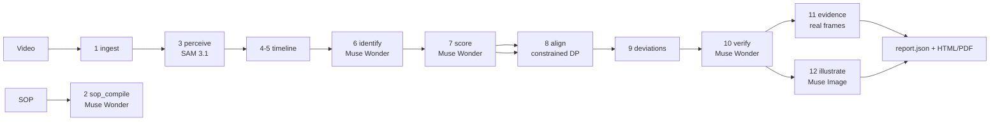

# Process Watcher

> **Not what the paperwork says — what actually happened.**

Process Watcher checks a recorded physical procedure against its written SOP and flags
**missed steps**, **out-of-order steps** and **wrong tools** with exact timestamps, a
plain-language explanation, and evidence cut from the real video. It was built for the
**Meta Global AI Developer Hackathon** (theme: *Push the Frontier*).

- **Problem:** SOP audits are manual, slow and inconsistent. Video exists but nobody
  watches it.
- **Solution:** a deterministic compliance engine over model-supplied perception. SAM 3.1
  tracks hands and tools; Muse Wonder compiles the SOP, scores the actions and verifies the
  findings; a constrained dynamic-programming aligner — not the model — decides compliance.
  Muse Image draws "what correct looks like" for each finding.
- **Why it is auditable:** every verdict carries step id, track ids, timestamps and a
  real-frame image; illustrations are watermarked and never counted as evidence.



The full stage table is in [docs/architecture.md](docs/architecture.md).

## Windows one-click demo (showcase)

This is the recommended path for demonstrating the app on a Windows laptop. It is **not**
a standalone executable: Python 3.12 (managed by uv) and Node.js are still required.

**Requirements:** Windows 10/11, [uv](https://docs.astral.sh/uv/) with Python 3.12,
Node.js 22.12+ with npm, and ffmpeg only if you also want to analyse new clips. The three
frozen demo cases need no API key, no network and no ffmpeg.

**First-time setup** (once, from the repository root):

```bash
uv sync
npm --prefix web ci
```

**Launch:** double-click `Start-ProcessWatcher.bat`. It resolves the project directory
from the batch file, checks uv/Node/npm and the installed dependencies, refuses to start
if port 8000 or 5173 is already in use, starts the API with `PW_MODE=demo`, starts the Vite
dev server, waits for both health checks, verifies the frozen cases, and only then opens
`http://127.0.0.1:5173/demo` in the default browser. Logs are written to `.runtime\logs\`.
Running the launcher twice reuses the existing instance instead of starting duplicates.

**Stop:** double-click `Stop-ProcessWatcher.bat`. It stops only the backend and frontend
PIDs recorded by the launcher, after checking their start time and command line; it never
kills unrelated Python, Node.js or other user processes and keeps the logs.

**Demo mode:** `PW_MODE=demo` serves the committed, checksummed cases under `demo/cases/`
read-only. Every model client is cache-only, so the demo makes **no outbound Meta API
calls**. The launcher also points `PW_ENV_FILE` at a missing file and clears
`META_API_KEY` for its child processes, so your real `.env` is not read in demo mode.

**Live mode is separate.** Do not launch live mode through the demo batch files. Copy
`.env.example` to `.env`, fill in `META_API_KEY` and `PW_ACCESS_CODE` locally, never commit
that file, and use the manual commands below:

```bash
cp .env.example .env       # Windows: Copy-Item .env.example .env
uv run pw config           # shows "set"/"missing" only, never the values
PW_MODE=live uv run uvicorn pw.api.main:app --port 8000
npm --prefix web run dev
```

`live` spends money and sends frames to the Meta API; the three demo cases do neither.
Process Watcher is a local web application that requires Python and Node.js; there is no
bundled installer or standalone executable.

## 60-second quickstart

Requirements: Python 3.12 + [uv](https://docs.astral.sh/uv/), Node 22.12+, ffmpeg/ffprobe
on PATH, and (for live runs) a Meta Model API key.

```bash
uv sync
npm --prefix web ci
cp .env.example .env      # set META_API_KEY and PW_ACCESS_CODE
uv run pw config
```

Windows (PowerShell) uses the same commands; `Copy-Item .env.example .env` replaces `cp`.
macOS/Linux need `brew install ffmpeg` / `apt install ffmpeg` once.

Run one clip through the pipeline (replay uses the recorded model responses and costs
nothing):

```bash
uv run pw run --mode replay --video bench/dev/videos/dev_02_correct.mp4 --sop bench/sops/P-A-keyboard-clean.md
```

Start the API and the web app:

```bash
uv run uvicorn pw.api.main:app --port 8000
npm --prefix web run dev
```

The demo pack works without a network or an API key. The `/demo` routes are not behind
the access-code gate, and the Vite dev server proxies `/demo` to port 8000:

```bash
# macOS / Linux
PW_MODE=demo uv run uvicorn pw.api.main:app --port 8000
curl http://localhost:8000/demo/cases
```

```bat
REM Windows CMD
set PW_MODE=demo
uv run uvicorn pw.api.main:app --port 8000
curl.exe http://localhost:8000/demo/cases
```

```powershell
# Windows PowerShell
$env:PW_MODE="demo"
uv run uvicorn pw.api.main:app --port 8000
curl.exe http://localhost:8000/demo/cases
```

The gallery at `http://localhost:5173/demo` lists the three keyboard-cleaning cases and
opens each one's timeline and video from the frozen, checksummed pack.

## How each Meta model is used

| Model | Role | Why this model |
|---|---|---|
| **SAM 3.1** | Tracks hands and tools frame-by-frame in 15 fps chunks and returns one-bit masks. | Promptable segmentation is the only reliable way to get per-object polygons on real frames; masks become the evidence overlay. |
| **Muse Wonder** | Compiles the SOP into a step graph, labels each track, scores every timeline segment against every step, verifies findings and writes explanations. | Long-context video reasoning with strict JSON output; it is strong at "which of these actions is happening". |
| **Muse Image** | Draws one "what correct looks like" diagram per flagged step. | A visual reference is faster to review than text; the output is watermarked and kept out of evidence. |

The model never decides compliance: it produces likelihoods and labels, and the aligner
turns those into findings. Scoring is repeated three times and the median is used because
Muse Wonder at temperature 0 is still not deterministic.

<!-- RESULTS:models -->
Measured contribution on the dev split (see [`docs/results/ablation_dev.md`](docs/results/ablation_dev.md)):

- Removing the **verifier** changes F1 from 0.087 to 0.074 — it mostly improves
  explanations, not verdicts.
- The **oracle** row (ground-truth deviations fed straight in) scores 1.000 and the
  **empty** row scores 0.000, which bounds the metric.
- The two Wonder-only baselines and the `no_aligner` / `no_identity_vote` rows were **not
  run** in this timebox and are reported as such, not estimated.
- **Muse Image** has no accuracy role by design: its diagrams never enter evidence or the
  decision, so its contribution is review speed only.

## Results

Measured with `pw-bench`; dev is the in-sample calibration split, held-out is the single
pass with frozen thresholds (`config/thresholds.json`, `sha256 1963006…d69a21`).

| Split | P | R | F1 | F1 95% CI | False flags / compliant clip | Timestamp MAE |
|---|---|---|---|---|---|---|
| dev (15 clips) | 0.054 | 0.222 | 0.087 | 0.000–0.186 | 1.67 | 0.52 s |
| held-out (9 clips) | 0.182 | 0.333 | 0.235 | 0.000–0.533 | 0.67 | 0.08 s |

By type (held-out): `missed` recall **1.00** (both planted missed steps found with
confidence 1.0), `out_of_order` and `wrong_tool` recall **0.00** at the flag threshold —
they are detected but sit in the review lane or are typed as `missed`. Full tables:
[`docs/results/heldout.md`](docs/results/heldout.md) and
[`docs/results/tune_dev.md`](docs/results/tune_dev.md).

**Reading the numbers honestly:** recall on clearly missing steps is high, but precision is
low because short neighbouring actions (wipe keycaps vs wipe frame) are under-detected, and
tool substitutions are reported as missing steps. Threshold calibration on dev could not
reach the planned ≤0.3 false flags per compliant clip; the best-F1 pair is frozen and the
shortfall is documented rather than hidden.

## Cost and latency

<!-- RESULTS:cost -->
- Dev: **$52.07** for 15 clips (about **$5.24 per video-minute**), ~20 minutes wall time per
  clip with 15 fps SAM tracking, three scoring repeats and illustration QA.
- Held-out: **$27.33** for 9 clips ($5.48 per video-minute).
- Total live spend for the whole evaluation: **$135.57**, inside the $150 credit budget.
- A replay run costs **$0**, serves the recorded responses, and is the default development
  mode; `PW_MODE=demo` makes no outbound calls at all.

## Limitations

<!-- RESULTS:limitations -->
- **Short, similar actions are the weak spot.** The segment scorer cannot reliably separate
  a 1.5 s inspection from the wiping that surrounds it, so compliant clips can carry a
  high-confidence `missed` finding for `stp_06`/`stp_07`.
- **Wrong-tool and out-of-order findings are under-flagged.** Tool substitutions are
  reported as missing steps; order violations are classified correctly but land at
  confidence 0.30, below the 0.90 flag threshold, and therefore appear in the review lane.
- **Recognition needs a clear view.** Long occlusion or a hand leaving the frame can push
  the deterministic coverage guard to `procedure_not_recognized` (3 of 15 dev clips in the
  first pass; the guard is retained because it prevents false acceptance).
- **The verifier adds explanation quality, not accuracy**, and SAM/identity are the slow
  stages (identity about half of the wall time).
- A ranked failure analysis with root causes and fix directions is in
  [`docs/results/failures.md`](docs/results/failures.md).

## Security and privacy

- Every `/runs` route requires the `X-Access-Code` header; `/healthz` is public.
- Uploads are capped (500 MB, 180 s, 3840x2160) and rejected before decoding if the
  container is not a video; zip bombs are refused on magic bytes.
- Response headers are hardened (`nosniff`, `Referrer-Policy: no-referrer`, a strict CSP).
- Runs are stored on the local filesystem under `runs/`; no third-party analytics, no
  database, no secrets in the browser bundle. Model calls go only through `pw.clients`
  and are recorded in a local ledger.
- Video never leaves the machine except as frames sent to the Meta Model API during a live
  run; `replay` and `demo` modes make no outbound calls.

## Licence

The code is MIT licensed (see [LICENSE](LICENSE)). SAM 3.1 weights and materials are
provided under the **SAM License**; this project uses the hosted Meta Model API and does
not redistribute weights. Muse Wonder and Muse Image are used through the same API and are
subject to Meta's model terms.

## Repository map

```
src/pw/{api,clients,core,ingest,pipeline,security}     platform
src/pw/{perception,timeline,sop,align,illustrate,evidence,report,bench,data,demo}
web/src/{app,features,ui,api,types}                    React + TypeScript UI
contracts/schemas                                      JSON Schemas for every artifact
bench/{sops,golden,dev,heldout}                        15 dev + 9 held-out clips
demo/cases                                             three frozen, checksummed cases
docs/{adr,results,security,demo,submission}            decisions and measured results
```

## Verification

```bash
uv run ruff check .
uv run mypy src
uv run pytest -m "not integration and not live" -q
npm --prefix web run test -- --run
npm --prefix web run typecheck
uv run python scripts/readme_check.py
```

## Contributors

- Rifat Sarkar — design, implementation, dataset, evaluation.
