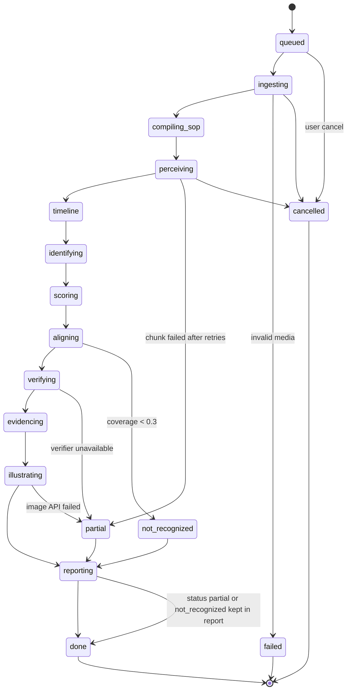
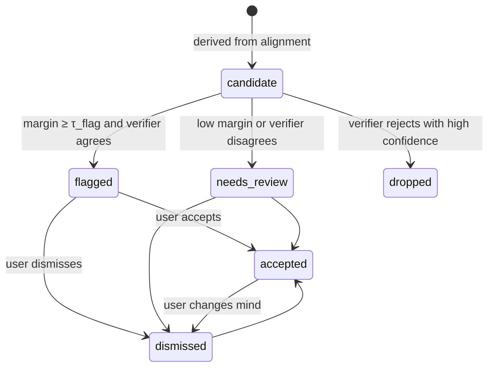

# 02_AppFlow.md: Process Watcher · User Journey and State Machine
> Layer 01 · v1.0 · 2026-10-25 · Screen-by-screen flow, interactions, success states, fallbacks. IDs refer to `01_PRD.md`. Visual details live in `03_UI_Spec.md`.

## 1. Screen map
```
[Access gate] ─► [Upload + SOP review] ─► [Processing] ─► [Review] ─► [Export]
      │                                       │              ▲
      └────────► [Demo gallery] ──────────────┴──────────────┘ (frozen cases open Review directly)
```
| Route | Screen | Entry condition |
|---|---|---|
| `/` | Access gate → Upload | No valid access code in session → gate; else Upload |
| `/runs/:id` | Processing, then Review (same route; view switches on run status) | Run exists |
| `/demo` | Demo gallery | Always reachable; works offline in `demo` mode |
| `/runs/:id/report.html` · `.pdf` | Downloads | Run status `done` / `partial` / `not_recognized` |

## 2. Screens, interactions, success and fallback states

### 2.1 Access gate
- **Purpose:** protect API spend on the public demo (NFR-05).
- **Elements:** access-code field, "Continue", link "Open demo gallery (no code needed)".
- **Interactions:** submit → `GET /runs` with `X-Access-Code`; 200 → store code in memory + `sessionStorage` (never `localStorage`); 401 → inline error "That code isn't valid."
- **Success:** lands on Upload. **Fallback:** the demo gallery stays reachable without a code (frozen cases only).

### 2.2 Upload + SOP review (FR-01, FR-02)
- **Elements:** video dropzone (mp4/mov/webm/mkv, ≤180 s, ≤500 MB), SOP dropzone or paste box (md/txt/pdf), "Compile SOP" button, step-graph editor, "Start run" button, cost/time estimate line.
- **Flow:** 1) drop video (client checks type/size, shows duration) → 2) drop/paste SOP → 3) **Compile SOP** → `POST /sop/compile` → editable list → 4) edit → 5) **Start run** → `POST /runs` (multipart + optional `step_graph` override) → navigate to `/runs/:id`.
- **Step editor interactions:** reorder (drag or ↑/↓), edit text, tool/part chips (add/remove), toggle **Critical**, ordering mode per step (`strict` / `any order within group`), delete step, add step. Inline validation: at least 2 steps, unique ids, every step has an action text.
- **Success:** Start enabled only when video valid + step graph valid. **Fallbacks/errors:** see §6 (E-01..E-06).

### 2.3 Processing (FR-15)
- **Elements:** 12-stage stepper (Ingest · Compile SOP · Perceive · Timeline · Identify tools · Score segments · Align · Verify · Evidence · Illustrate · Report · Done), per-stage % and elapsed, running cost meter vs cap, "Cancel run".
- **Flow:** subscribes to `GET /runs/:id/events` (SSE). Late open/refresh → replay then live. Finished stages stay ticked.
- **Partial results:** once `Align` completes, a "Preview findings" link appears; Review opens read-only until `Report` finishes.
- **Success:** `done` event → auto-switch to Review. **Fallbacks:** stage failure → amber banner on that stage with reason + **Continue with partial** (degraded valid report) or **Retry stage**; cap reached → banner "Spend cap reached; showing partial report"; cancel → run status `cancelled`, artifacts kept until retention purge.

### 2.4 Review (FR-11)
- **Layout:** left = video + dual-lane timeline; right = deviation panel. Header: run title, status chip, cost, "Export" menu.
- **Video + overlay:** frame-step, speed (0.25×–2×), **Overlay** toggle with per-concept and per-track toggles; hover shows `#id concept`; clicking a track opens the **Track inspector** (its hold intervals and identity/confidence).
- **Dual-lane timeline:** top lane = SOP steps (expected order, widths proportional to aligned intervals); bottom lane = observed activity (aligned intervals + idle). Deviation markers sit on the lanes, colour by type; `needs_review` markers are dashed.
- **Deviation panel:** list sorted by time (toggle: by severity); filter chips (type, status, critical only). Selecting a card seeks the video, highlights the lane marker and shows: type badge · severity · confidence · explanation · **Evidence** carousel (2–4 real frames with masks + clip) · **What correct looks like** (illustration with permanent badge) · actions **Accept**, **Dismiss**, **Add note**.
- **Keyboard:** `Space` play/pause · `←/→` frame step · `J/K/L` back/pause/forward · `N` / `P` next/previous deviation · `O` toggle overlay · `E` open evidence · `A` accept · `D` dismiss · `?` shortcuts help.
- **Decisions:** Accept/Dismiss/Note → `PATCH /runs/:id/review`; optimistic update, rollback + toast on failure. Decisions never change model output; they are stored in `review.json` and shown in the exported report.
- **Special states:** `procedure_not_recognized` → full-width explanation card ("This video does not match the SOP closely enough to check it"), overlay and tracks still viewable, no deviation list; `needs_review` items live in a separate collapsible group; `evidence_unavailable` → card shows "No clear frame found" with the time range link; `illustration_unavailable` → "No illustration (reason)" placeholder.

### 2.5 Export
- **Menu:** Download HTML report · Download PDF report · Copy share link (same access rules apply) · Download evidence bundle (zip of frames + manifest).
- **Success:** file downloads; HTML opens offline with no external references (FR-12). **Fallback:** PDF failure → toast with "Download HTML instead".

### 2.6 Demo gallery (FR-14)
- **Elements:** three case cards (one per procedure; one with a planted mistake, one compliant), badge **OFFLINE**, "Open".
- **Flow:** Open → Review of the frozen run (read-only decisions disabled; notes stay local). Works with the network disabled.

## 3. Run state machine

| Status | Meaning | Report available |
|---|---|---|
| `done` | All stages succeeded | Yes |
| `partial` | At least one non-critical stage degraded; banner lists which | Yes (valid, flagged as degraded) |
| `not_recognized` | Guard decided video ≠ SOP | Yes (no deviations) |
| `failed` | Unrecoverable (invalid media, SAM unavailable after fallback, cap hit before align) | No |
| `cancelled` | User cancelled | No |

## 4. Deviation lifecycle (per finding)

`dropped` findings are logged in the manifest (count only), never shown. Accept/Dismiss are human annotations on top of the model's `status`.

## 5. Journeys
### 5.1 Primary journey (engineer, live run)
Gate → Upload video + SOP → Compile → fix one tool name → Start → Processing (≈ 4 min) → Review opens on the first deviation → inspect evidence + diagram → Accept two, Dismiss one → Export HTML.

### 5.2 Judge journey (3-minute demo; see `06_Plan.md` §1A)
Demo gallery → open the held-out case with a planted mistake → timeline shows two markers → click one: evidence frame with masks, explanation, "what correct looks like" → show numbers slide (held-out F1, ablation, $/min) → second domain loads in seconds.

### 5.3 Degraded journey
Start live run → Muse Image outage → run finishes `partial` → Review shows "No illustration (service unavailable)" on each card; everything else intact → Export works.

## 6. Error catalogue (message, cause, recovery)
| Code | Where | User-facing message | Cause | Recovery |
|---|---|---|---|---|
| E-01 | Upload | "That file type isn't supported. Use mp4, mov, webm or mkv." | Wrong magic number / extension | Pick another file |
| E-02 | Upload | "Video is longer than 3 minutes." | Duration > 180 s | Trim and retry |
| E-03 | Upload | "File is larger than 500 MB." | Size cap | Compress/trim |
| E-04 | Compile | "We couldn't read steps from that SOP." | Empty/garbled SOP, compile failed after repair | Edit text or paste plain steps |
| E-05 | Start | "Access code required." / "Too many requests, try again in N s." | 401 / 429 | Enter code / wait |
| E-06 | Start | "The system is busy. Your run is queued (position N)." | Concurrency limit | Wait (SSE shows position) |
| E-07 | Processing | "Stage *X* failed. Continue with a partial report?" | Retries exhausted | Continue partial / retry stage |
| E-08 | Processing | "Spend cap reached." | `PW_SPEND_CAP_USD` | View partial report |
| E-09 | Review | "This video doesn't match the SOP." | `procedure_not_recognized` | Check SOP/video pairing |
| E-10 | Review | "Couldn't save your decision." | PATCH failed | Retry; toast keeps local state |
| E-11 | Export | "PDF failed. Download HTML instead." | Headless print failure | Use HTML |
| E-12 | Any | "Session expired. Enter the access code again." | 401 mid-session | Re-enter code |
| E-13 | Any | "Run not found or expired." | 404 / retention purge (24 h) | Start a new run |

All errors use the API shape `{ "error": { "code": "E-xx", "message": "…" } }` and never expose stack traces or file paths.

## 7. UI state checklist (implemented by G5)
access gate · upload · SOP review · processing · stage failed / partial · review (flagged, needs_review) · procedure_not_recognized · evidence_unavailable · illustration_unavailable · demo gallery · empty list · loading skeletons · offline badge.
