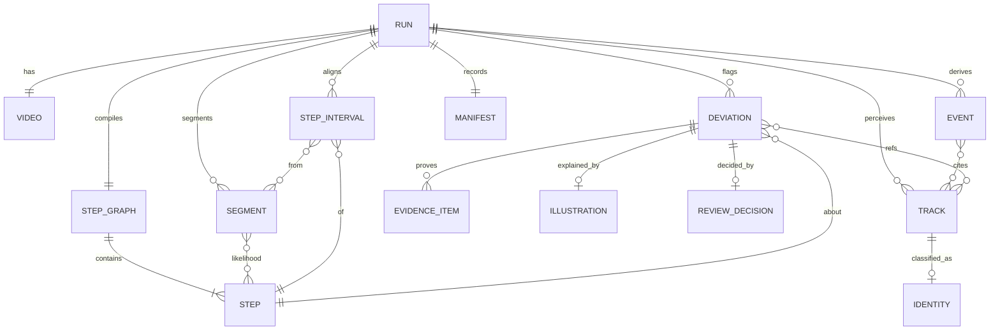

# 05_Schema.md: Process Watcher · Data Schema, Contracts and Access Rules
> Layer 03 · v1.0 · 2026-10-25 · Defined before any code. Machine-readable versions live in `contracts/*.schema.json` (DATA owns; frozen at C1 / tag `contracts-v1`). This file is the human spec; if they disagree, fix the schema and bump `schema_version`.

## 1. Overview and decision
**There is no relational database** (TRD D-3). The "tables" are JSON artifacts in a per-run directory; "primary keys" are stable string IDs; "foreign keys" are ID references validated by the cross-field invariants in §11; "RLS" is the access model in §13 (run-scoped capability + access code + retention). Every artifact carries `schema_version` (semver) and is validated on write and on read.

| Artifact | Contract | Written by stage | Read by |
|---|---|---|---|
| `step_graph.json` | `sop.schema.json` | sop_compile | perceive, score, align, UI |
| `tracks.json` | `tracks.schema.json` | perceive | timeline, identify, evidence, UI overlay |
| `timeline.json` | `timeline.schema.json` | timeline | score, align, UI |
| `identities.json`, `likelihoods.json`, `alignment.json` | `alignment.schema.json` ($defs) | identify, score, align | align, verify, report, UI |
| `evidence_manifest.json` | `report.schema.json` ($defs) | evidence | report, `pw verify-evidence` |
| `report.json` | `report.schema.json` | report | API, UI, export |
| `manifest.json` | `manifest.schema.json` | orchestrator | report, bench |
| `review.json` | `review.schema.json` | API (PATCH) | UI, export |
| `gt/*.yaml`, `manifest.json` (bench) | `bench/gt.schema.json` | humans (DATA) | bench |
| `config/thresholds.json` | `thresholds.schema.json` | tuned by T-3.10 | all stages |

## 2. Entities, relations and ID formats

| Entity | ID format | Example | Uniqueness scope |
|---|---|---|---|
| Run | `run_` + 26-char Crockford base32 (128-bit random) | `run_01J9ZQ8M3K4V7B2C5D6E8F0GHJ` | global |
| Step | `stp_` + 2+ digits | `stp_05` | per run (from SOP order, never renumbered after edit; new = next free) |
| Track | `trk_` + 3+ digits | `trk_007` | per run (global after stitching) |
| Chunk | `chk_` + 2 digits | `chk_03` | per run |
| Event | `evt_` + 3+ digits | `evt_041` | per run |
| Segment | `seg_` + 3+ digits | `seg_012` | per run |
| Step interval | `int_` + 2+ digits | `int_05` | per run |
| Deviation | `dev_` + 3+ digits | `dev_002` | per run |
| Evidence item | `evd_` + 3+ digits | `evd_004` | per run |
| Illustration | `ill_` + 3+ digits | `ill_002` | per run |

**Conventions:** time `t*` = seconds (float, ≥ 0, rounded to 3 decimals); frame indices (0-based) only in `tracks`; coordinates normalised to `[0,1]` of the analysis frame (`x` right, `y` down); hashes are lowercase hex SHA-256; timestamps `created_at` are ISO 8601 UTC with `Z`; enums are lowercase snake_case.

## 3. `step_graph` (sop.schema.json)
| Field | Type | Req | Constraints |
|---|---|---|---|
| `schema_version` | string | ✔ | semver |
| `sop_id` | string | ✔ | `sop_` + 8 hex of text hash |
| `title` | string | ✔ | 1–120 chars |
| `source` | object | ✔ | `{kind: md\|txt\|pdf\|pasted, sha256}` |
| `steps[]` | array | ✔ | 2–40 items, order = SOP order |
| `steps[].id` | string | ✔ | `stp_NN`, unique |
| `steps[].idx` | int | ✔ | 1-based position |
| `steps[].text` | string | ✔ | 3–400 chars |
| `steps[].action` | string | ✔ | short verb phrase (`tighten`, `insert`) |
| `steps[].tools[]` | string[] | ✔ | each appears in the SOP text; may be empty |
| `steps[].parts[]` | string[] | ✔ | same rule |
| `steps[].ordering` | enum | ✔ | `strict` \| `unordered_group` |
| `steps[].group_id` | string\|null | | required iff `unordered_group` (`grp_NN`) |
| `steps[].critical` | bool | ✔ | explicit cues only |
| `steps[].visual_check` | string\|null | | what should be visible when done |
| `vocabulary.sam_concepts[]` | string[] | ✔ | 1–24 generic noun phrases, includes `hand` |
| `vocabulary.zones[]` | string[] | | concepts used for enter/exit events |
| `warnings[]` | string[] | | compile warnings (dropped hallucinated items etc.) |

## 4. `tracks` (tracks.schema.json)
| Field | Type | Req | Constraints |
|---|---|---|---|
| `schema_version`, `run_id` | string | ✔ | |
| `video` | object | ✔ | `{sha256, duration_s, analysis_fps, width, height, frame_count}` |
| `tracks[]` | array | ✔ | may be empty |
| `tracks[].id` | string | ✔ | `trk_###`, unique |
| `tracks[].concept` | string | ✔ | member of `vocabulary.sam_concepts` |
| `tracks[].first_t`, `last_t` | number | ✔ | `first_t ≤ last_t` |
| `tracks[].frames[]` | array | ✔ | strictly increasing `frame`, each `{frame:int, t:number, box:[x0,y0,x1,y1], score:number, mask?:{encoding:string, data:string} \| poly?: number[][]}` |
| `tracks[].source_chunks[]` | string[] | | `chk_NN` list (stitching provenance) |
| `stitching` | object | | `{fragmentation_ratio, merges, gaps_filled}` |

`mask.encoding` and the decode path are fixed by ADR-001; `poly` holds the simplified polygon used by the UI (≤ 64 points per frame).

## 5. `timeline` (timeline.schema.json)
| Field | Type | Req | Constraints |
|---|---|---|---|
| `events[]` | array | ✔ | sorted by `t_start`, ids unique |
| `events[].id` | string | ✔ | `evt_###` |
| `events[].type` | enum | ✔ | `hold_start` \| `hold_end` \| `contact_start` \| `contact_end` \| `move` \| `enter` \| `exit` |
| `events[].t_start`, `t_end` | number | ✔ | `t_start ≤ t_end` (point events: equal) |
| `events[].tracks[]` | string[] | ✔ | 1–3 existing `trk_###` (subject first) |
| `events[].confidence` | number | ✔ | 0–1 |
| `segments[]` | array | ✔ | non-overlapping, covers the video |
| `segments[].id` | string | ✔ | `seg_###` |
| `segments[].t_start`, `t_end` | number | ✔ | length 1–20 s |
| `segments[].salient_tracks[]` | string[] | ✔ | existing tracks |
| `segments[].event_ids[]` | string[] | ✔ | existing events |
| `segments[].kind` | enum | ✔ | `activity` \| `idle` |

## 6. `alignment` (alignment.schema.json: identities, likelihoods, alignment)
**`identities.json`:** `identities[]` `{track_id, label (vocabulary item | "other" | "unknown"), confidence, votes[{label,count}], crop_frames[int]}`.
**`likelihoods.json`:** `segments[]` `{segment_id, step_probs{stp_id|"none": number}, observed_tools[{track, label, confidence}], rationale_short, flags[] (e.g. scorer_unavailable)}`; each `step_probs` sums to 1 ± 0.02 after normalisation.
**`alignment.json`:**
| Field | Type | Req | Constraints |
|---|---|---|---|
| `path[]` | array | ✔ | one `{segment_id, step_id\|"none"}` per segment, in order |
| `intervals[]` | array | ✔ | `{id (int_NN), step_id, t_start, t_end, segment_ids[], mean_prob, margin}` |
| `cost` | object | ✔ | `{total, per_segment, coverage}` |
| `params` | object | ✔ | the `align.*` thresholds used (hash recorded in manifest) |
| `status` | enum | ✔ | `ok` \| `procedure_not_recognized` |

## 7. `evidence_manifest` (report.schema.json $defs)
`items[]` `{evidence_id, deviation_id, kind: "evidence", source_sha256, frame_index, t, render_version, params_hash, output_path, output_sha256, phash, track_ids[]}` plus optional `clip` `{path, sha256, t_start, t_end}`. Illustrations are **not** listed here.

## 8. `report` (report.schema.json)
| Field | Type | Req | Constraints |
|---|---|---|---|
| `schema_version`, `run_id`, `created_at` | string | ✔ | |
| `status` | enum | ✔ | `done` \| `partial` \| `not_recognized` |
| `degraded_stages[]` | string[] | ✔ | empty when `done` |
| `sop` | object | ✔ | embedded `step_graph` (possibly user-edited) |
| `video` | object | ✔ | `{sha256, duration_s, width, height}` (no filename, no operator) |
| `lanes` | object | ✔ | `{expected:[{step_id,idx}], observed:[{interval_id,step_id\|null,t_start,t_end}]}` |
| `deviations[]` | array | ✔ | see below |
| `summary` | object | ✔ | `{flagged, needs_review, dropped, by_type{missed,out_of_order,wrong_tool}}` |
| `manifest_ref` | string | ✔ | `manifest.json` |
| `notice` | string | | e.g. "Some analysis was unavailable: Illustrations." |

**`deviations[]` item**
| Field | Type | Req | Constraints |
|---|---|---|---|
| `id` | string | ✔ | `dev_###` |
| `type` | enum | ✔ | `missed` \| `out_of_order` \| `wrong_tool` |
| `status` | enum | ✔ | `flagged` \| `needs_review` |
| `severity` | enum | ✔ | `high` \| `medium` |
| `step_id` | string | ✔ | existing step |
| `relates_to_step_id` | string\|null | | out-of-order: the step it should follow |
| `t_start`, `t_end` | number | ✔ | |
| `track_ids[]` | string[] | ✔ | ≥ 1, existing |
| `confidence` | number | ✔ | 0–1 |
| `margin` | number | ✔ | counterfactual Δ |
| `explanation` | string | ✔ | ≤ 40 words, validated |
| `verifier` | object | ✔ | `{ran: bool, agreed: bool\|null, note?: string}` |
| `expected_tools[]`, `observed_tools[]` | string[] | | wrong_tool |
| `evidence[]` | array | ✔ | items with `kind: "evidence"`; may be empty only if `evidence_unavailable: true` |
| `evidence_unavailable` | bool | ✔ | |
| `illustration` | object\|null | | `{id (ill_###), kind: "illustration", path, sha256, watermark: true, qa{verdict, attempts, reason?}}`; `null` + `illustration_unavailable_reason` when absent |
| `illustration_unavailable_reason` | string\|null | | |

**Example (abridged)**
```json
{"schema_version":"1.0.0","run_id":"run_01J9ZQ8M3K4V7B2C5D6E8F0GHJ","status":"done","degraded_stages":[],
 "deviations":[{"id":"dev_002","type":"wrong_tool","status":"flagged","severity":"high","step_id":"stp_06",
   "t_start":72.4,"t_end":81.0,"track_ids":["trk_007","trk_002"],"confidence":0.86,"margin":3.8,
   "explanation":"Step 6 needs the Phillips screwdriver; a flat-head was in hand from 01:12 to 01:21.",
   "verifier":{"ran":true,"agreed":true},"expected_tools":["Phillips screwdriver"],"observed_tools":["flat-head screwdriver"],
   "evidence":[{"evidence_id":"evd_004","kind":"evidence","t":74.2,"frame_index":1113,"output_sha256":"…"}],
   "evidence_unavailable":false,
   "illustration":{"id":"ill_002","kind":"illustration","watermark":true,"qa":{"verdict":"pass","attempts":1}},
   "illustration_unavailable_reason":null}]}
```

## 9. `manifest` and ledger (manifest.schema.json)
| Field | Type | Req | Notes |
|---|---|---|---|
| `run_id`, `created_at`, `finished_at` | string | ✔ | |
| `mode` | enum | ✔ | `live` \| `replay` \| `fake` \| `demo` |
| `inputs` | object | ✔ | `{video_sha256, sop_sha256, step_graph_sha256, edited_by_user: bool}` |
| `models[]` | array | ✔ | `{name: muse-wonder-1.0 \| muse-image-1.0 \| sam-3.1, version_or_date, endpoint}` |
| `config_sha256` | string | ✔ | hash of `config/thresholds.json` |
| `stages[]` | array | ✔ | `{stage, status, started_at, duration_ms, cache_hit, cost_usd}` |
| `ledger` | object | ✔ | `{total_usd, by_model{}, calls, cache_hits, spend_cap_usd, cap_reached: bool}` |
| `dropped_candidates` | int | ✔ | count only |
| `git_commit`, `app_version` | string | ✔ | |
Per-call ledger rows (`ledger.json`): `{ts, stage, model, tokens_in, tokens_out, images, sam_units, usd, latency_ms, cache_hit, request_sha256}`; no prompts, no headers.

## 10. `review` (review.schema.json)
`decisions[]` `{deviation_id, decision: accepted|dismissed, note (≤ 500 chars), decided_at}`; one latest decision per deviation; `deviation_id` must exist in `report.json`. Notes are plain text (rendered escaped).

## 11. Cross-field invariants (enforced by validators and the report builder)
1. `t_start ≤ t_end` everywhere; all times within `[0, video.duration_s]` (±0.05 s tolerance).
2. Every referenced `trk_`, `evt_`, `seg_`, `stp_`, `dev_` ID exists in its source artifact.
3. A deviation has ≥ 1 `track_id`, a `step_id`, and a time range (NFR-04).
4. `evidence[].kind == "evidence"` and `illustration.kind == "illustration"`; an illustration can never appear in `evidence[]` and vice versa (FR-09/10).
5. `illustration.watermark == true` always.
6. `status == "not_recognized"` ⇒ `deviations == []` and `summary` zeros.
7. `status == "done"` ⇒ `degraded_stages == []`.
8. `flagged` ⇒ `confidence ≥ tau_flag` and (`verifier.ran == false` ⇒ `degraded_stages` contains `verify`).
9. Step IDs are unique and never renumbered after a user edit; deleted steps are absent, new steps take the next free number.
10. Unordered-group members share a `group_id`; a `strict` step has `group_id == null`.
11. No filename, operator name, or free-text user identifier appears in `report.json` or the exported report.

## 12. Run store layout
```
runs/<run_id>/
  input/            video.<ext>, sop.<ext|txt>          (random names, never user filenames)
  stages/           ingest.json, step_graph.json, tracks_raw/chunk_k.json, tracks.json, timeline.json,
                    identities.json, likelihoods.json, alignment.json, verify.json, <stage>.key
  media/            analysis.mp4
  evidence/         evd_###.png, evd_###.mp4, evidence_manifest.json
  illustrations/    ill_###.png
  report.json  report.html  report.pdf  manifest.json  ledger.json  review.json
```
`demo/cases/<case_id>/` mirrors this layout (frozen, checksummed, read-only). Bench clips live outside git; manifests (`bench/{dev,heldout}/manifest.json`) hold `{clip_id, procedure, sha256, duration_s, storage_ref}`.

## 13. Access, security and retention rules ("Auth and RLS")
| Rule | Detail |
|---|---|
| Identity model | No user accounts (OOS-3). Access = knowledge of the **access code** (`X-Access-Code`) **and** the unguessable `run_id` (128-bit). |
| Route policy | All `/runs/*`, `/sop/*` routes require the code. `/healthz` and `/demo/*` are public and read-only. |
| Object-level check | Every `/runs/{id}/…` handler resolves the run directory through one function that (a) validates the ID format, (b) checks existence, (c) refuses paths outside `runs/<id>/`. |
| Artifact allowlist | Only files under `evidence/`, `illustrations/`, `media/`, and the named JSON artifacts are served; `input/` raw uploads are never served back. |
| Rate limit | Per-IP token bucket (default 30 req/min, burst 10); run creation additionally limited by queue length and spend cap. |
| Retention | Runs older than **24 h** are purged (files + store entry) by a scheduled job; `demo/cases` exempt. |
| Data minimisation | Reports contain hashes, not filenames; no operator names; no face prompts or identification; bench `operator` metadata stays in `bench/` only. |
| Secrets | `META_API_KEY`, `PW_ACCESS_CODE` only in env / host secret store; never in artifacts, logs, cache files, or the client bundle. |
| Integrity | Source video, evidence outputs and illustrations are hashed; `pw verify-evidence` proves evidence is re-derivable from the source. |

## 14. Bench and config schemas
**`bench/gt.schema.json` (per clip):** `{clip_id, procedure (A|B|C), sop_file, compliant: bool, operator: string (bench-only), camera: string, instances: {concept: int}, steps: [{step_id, t_start, t_end}], deviations: [{type: missed|out_of_order|wrong_tool, step_id, t_start, t_end, note?}]}`. Rules: `compliant ⇒ deviations == []`; step intervals within clip duration; step IDs exist in the golden step graph.
**`bench/<split>/manifest.json`:** `{split, clips: [{clip_id, procedure, sha256, duration_s, storage_ref, gt_path}]}`. **`bench/HELDOUT.lock`:** `{created_at, commit, files: {path: sha256}}`.
**`thresholds.schema.json`:** exactly the keys in `04_TRD.md` §7; unknown keys rejected; numeric ranges validated (probabilities 0–1, penalties ≥ 0).

## 15. Versioning and change process
- `schema_version` is semver: patch = clarification, minor = additive optional field, major = breaking.
- **C1 freeze** (end of D2): tag `contracts-v1`. After C1 any contract change is its **own task** (new `T-x.y` in `06_Plan.md`), updates schema + examples + generated TS types + this file + OpenAPI in one commit, and bumps the version.
- Readers must tolerate unknown optional fields (forward-compatible); writers never emit fields not in the schema.
- Generated TS types (`web/src/types/generated/*`) are never edited by hand; CI fails if `npm --prefix web run gen:types` produces a diff.
