# Process Watcher architecture

Process Watcher turns a recorded physical procedure into an auditable compliance report.
It compiles the written SOP, tracks the objects and hands in the video, aligns the observed
actions to the SOP deterministically, and attaches real-frame evidence to every finding.

```mermaid
flowchart LR
    V[Video upload] --> ING[1 ingest<br/>720p CFR + PTS map]
    S[SOP text] --> CMP[2 sop_compile<br/>Muse Wonder]
    ING --> SAM[3 perceive<br/>SAM 3.1 chunks]
    SAM --> STI[4 stitch + polygons]
    STI --> TML[5 timeline<br/>contacts, holds, segments]
    CMP --> SEG
    TML --> IDN[6 identify<br/>Muse Wonder · median of 3]
    IDN --> SEG[7 score<br/>step likelihoods]
    SEG --> ALN[8 align<br/>constrained DP]
    ALN --> DEV[9 deviations<br/>missed · out of order · wrong tool]
    DEV --> VER[10 verify<br/>Muse Wonder + explanations]
    VER --> EVD[11 evidence<br/>real frames + SAM masks]
    VER --> ILL[12 illustrate<br/>Muse Image, watermarked]
    EVD --> REP[report.json + HTML/PDF]
    ILL --> REP
```

## The 12 stages

| Stage | What it does | Model / module |
|---|---|---|
| `ingest` | Normalises VFR phone video to 15 fps analysis frames at 720p and records the PTS time map. | ffmpeg, `pw.ingest` |
| `sop_compile` | Parses the SOP into an ordered step graph (tools, parts, critical flag, any-order groups). | Muse Wonder, `pw.sop` |
| `perceive` | Tracks hands and tools with SAM 3.1 in chunks, then stitches chunk tracks. | SAM 3.1, `pw.perception` |
| `timeline` | Derives hold/contact/enter/exit events and cuts activity segments. | `pw.timeline` |
| `identify` | Labels each track by majority vote over three cropped frames. | Muse Wonder, `pw.perception.identity` |
| `score` | Scores every timeline segment against every step, median of k=3 repeats. | Muse Wonder, `pw.align.scorer` |
| `align` | Finds the minimum-cost monotonic path through the segments, with skip, back and abstain costs. | `pw.align.aligner` (deterministic) |
| `deviations` | Classifies missed, out-of-order and wrong-tool findings from the alignment. | `pw.align.deviations` |
| `verify` | Re-checks findings and writes one plain-language explanation per finding. | Muse Wonder |
| `evidence` | Extracts the best real frame per finding and draws SAM polygons on it. | ffmpeg, PIL, `pw.evidence` |
| `illustrate` | Generates a "what correct looks like" diagram, watermarks it and QAs it. | Muse Image + Muse Wonder QA |
| `report` | Assembles the contract-valid report, HTML export and PDF. | `pw.report` |

Every stage is cacheable and resumable: a stage key hashes its inputs and dependency
artifacts, so a warm rerun short-circuits. A failed model stage degrades in place (for
example `verifier_unavailable`) instead of discarding the run, and the spend cap writes a
partial, schema-valid report.

## Determinism boundary

The language and image models only supply perception: step likelihoods, track labels,
explanations and diagrams. The compliance decision comes from the dynamic-programming
aligner and the rule-based deviation classifier, so the same artifacts always produce the
same verdict. Scoring is sampled three times because Muse Wonder at temperature 0 is not
deterministic; the median damps that variance.

## Data and storage

* `runs/<run_id>/` is the filesystem store: `stages/*.json`, `evidence/`, `illustrations/`,
  `media/analysis.mp4`, `ledger.json`, `report.json`, `review.json`.
* `contracts/schemas/` are the JSON Schemas every artifact is validated against.
* `bench/` holds the 15 dev and 9 held-out clips, their ground truth and the golden SOPs;
  `bench/HELDOUT.lock` freezes the held-out data before tuning.
* `demo/cases/` holds three checksummed, offline demo cases for `PW_MODE=demo`.

## Model usage and observed behaviour

* **SAM 3.1** — one noun phrase per request; cost is frames × concepts. Masks come back as
  compressed one-bit payloads which are decoded to polygons for the overlay and evidence.
* **Muse Wonder** — strict JSON structured output for compile, scoring, verification and
  illustration QA. Reasoning tokens dominate the bill; temperature 0 still varies, so the
  scorer takes a median of three.
* **Muse Image** — one diagram per flagged step, always watermarked and never listed as
  evidence.

Measured cost and latency for the dev and held-out sets, plus the ablations, live in
[`results/`](results/).
